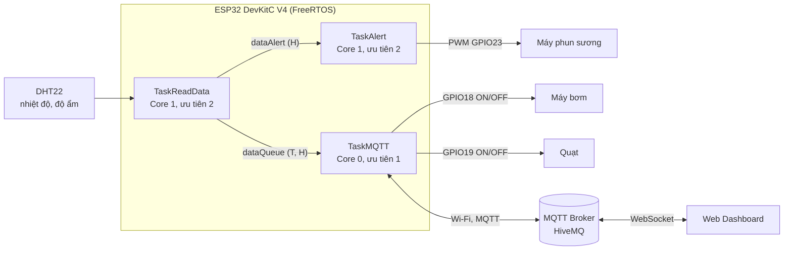

# Lab 3 – Đề 2: Giám sát vườn cây công nghiệp bằng ESP32, FreeRTOS và MQTT

Hệ thống giám sát và điều khiển môi trường vườn trồng cây công nghiệp (cà phê, hồ tiêu) dùng **ESP32 + cảm biến DHT22**, chạy **FreeRTOS** trên hai nhân, truyền dữ liệu qua **MQTT** và hiển thị trên **Web Dashboard**. Dự án được mô phỏng hoàn toàn trên **Wokwi**.

| | |
|---|---|
| **Sinh viên** | Nguyễn Tiến Hiếu |
| **MSSV** | 231432233 |
| **Lớp** | [điền tên lớp] |
| **Bài thực hành** | Lab 3 – Đề 2 |

## Liên kết nhanh

| Nội dung | Liên kết |
|---|---|
| Mô phỏng Wokwi | [Mở project trên Wokwi](https://wokwi.com/projects/479992109740419073) |
| Web Dashboard (demo) | [Mở trang web demo](https://doinucuoiem123-hue.github.io/Bao_Cao_Lab3_De2/) |
| Mã nguồn GitHub | [Bao_Cao_Lab3_De2](https://github.com/doinucuoiem123-hue/Bao_Cao_Lab3_De2) |

> **Lưu ý khi xem demo:** hãy **chạy mô phỏng Wokwi trước** (nút Start), rồi mới mở Web Dashboard. Web chỉ hiển thị nhiệt độ, độ ẩm và biểu đồ khi ESP32 đang gửi dữ liệu lên MQTT Broker. Nếu chưa chạy Wokwi, các thẻ số sẽ hiện `--.-`, đây là hiện tượng bình thường.

---

## 1. Giới thiệu và yêu cầu của đề

Đề 2 yêu cầu thiết kế mạch giám sát môi trường vườn cây công nghiệp, trong đó:

- ESP32 đọc **nhiệt độ** và **độ ẩm** từ DHT22, hiển thị qua **Serial**, đồng thời gửi lên **MQTT Broker** qua Wi-Fi.
- Web/App hiển thị 2 thẻ số (nhiệt độ, độ ẩm), 2 biểu đồ thời gian thực và 2 nút điều khiển thủ công (**Máy bơm**, **Quạt**).
- Vườn cần độ ẩm ổn định **40% – 60%**; thêm **máy phun sương** bật khi độ ẩm dưới ngưỡng.
- Hệ RTOS gồm 3 Task:
  - **Task truyền data** (Core 0): kết nối Wi-Fi, đọc `data Queue` và gửi lên MQTT.
  - **Task đọc data** (Core 1): đọc DHT22, in Serial, gửi `data Queue` (đầy đủ) và `data Alert` (độ ẩm).
  - **Task cảnh báo** (Core 1): đọc `data Alert` và điều khiển máy phun sương theo thuật toán.

## 2. Tính năng đã thực hiện

- Đọc DHT22 mỗi 2 giây, in nhiệt độ và độ ẩm ra Serial Monitor.
- 3 Task FreeRTOS ghim đúng Core, trao đổi dữ liệu bằng 2 Queue.
- Gửi dữ liệu JSON lên MQTT Broker công cộng HiveMQ.
- Web Dashboard: thẻ nhiệt độ, thẻ độ ẩm, thẻ mức phun sương, 2 biểu đồ thời gian thực (20 mẫu gần nhất), nút BẬT/TẮT máy bơm và quạt, nhật ký hoạt động.
- Máy phun sương điều khiển bằng **PWM** với 3 mức công suất và thời gian chạy khác nhau, **đếm ngược không chặn** (không dùng `delay()` dài).
- Tự động kết nối lại Wi-Fi và MQTT khi mất kết nối.
- Web kiểm tra dữ liệu hợp lệ và báo "dữ liệu cũ" nếu quá 12 giây không có bản tin mới.

## 3. Kiến trúc hệ thống

Luồng dữ liệu:

1. `TaskReadData` đọc DHT22, in Serial, rồi ghi dữ liệu vào `dataQueue` (nhiệt độ + độ ẩm) và `dataAlert` (độ ẩm).
2. `TaskMQTT` lấy dữ liệu từ `dataQueue`, đóng gói JSON và publish lên broker; đồng thời nhận lệnh bơm/quạt từ web.
3. `TaskAlert` lấy độ ẩm từ `dataAlert`, chọn mức phun sương và đếm ngược thời gian phun.
4. Web Dashboard subscribe topic dữ liệu để hiển thị, và publish lệnh khi người dùng bấm nút.

## 4. Phần cứng và sơ đồ chân

**Linh kiện (mô phỏng trên Wokwi):** ESP32 DevKitC V4, cảm biến DHT22, 3 LED kèm điện trở hạn dòng đại diện cho máy phun sương, máy bơm và quạt.

| Thiết bị | Chân thiết bị | Chân ESP32 | Ghi chú |
|---|---|---|---|
| DHT22 | VCC | 3V3 | Nguồn 3,3 V |
| DHT22 | SDA (DATA) | **GPIO15** | Đọc nhiệt độ, độ ẩm |
| DHT22 | GND | GND | |
| Máy phun sương (LED đỏ) | Anode qua điện trở | **GPIO23** | Xuất PWM 0 – 255 |
| Máy bơm (LED xanh dương) | Anode qua điện trở | **GPIO18** | BẬT/TẮT từ web |
| Quạt (LED xanh lá) | Anode qua điện trở | **GPIO19** | BẬT/TẮT từ web |

Cathode các LED nối GND. Sơ đồ chi tiết nằm trong file `diagram.json`.

## 5. Tổ chức FreeRTOS

### 5.1. Các Task

| Task | Core | Ưu tiên | Stack | Chức năng / chu kỳ |
|---|---|---|---|---|
| `TaskReadData` | 1 | 2 | 4096 | Đọc DHT22, in Serial, gửi 2 Queue; chu kỳ 2000 ms |
| `TaskAlert` | 1 | 2 | 4096 | Nhận độ ẩm, điều khiển PWM, đếm ngược; chờ Queue 50 ms rồi nghỉ 50 ms |
| `TaskMQTT` | 0 | 1 | 6144 | Kết nối Wi-Fi/MQTT, publish, nhận lệnh; nghỉ 20 ms khi online |

### 5.2. Các Queue

| Queue | Kiểu dữ liệu | Dung lượng | Gửi → Nhận |
|---|---|---|---|
| `dataQueue` | `SensorData { float temperature; float humidity; }` | 1 phần tử | `TaskReadData` → `TaskMQTT` |
| `dataAlert` | `float humidity` | 1 phần tử | `TaskReadData` → `TaskAlert` |

Cả hai Queue dùng `xQueueOverwrite()` nên luôn giữ **mẫu mới nhất** và không bao giờ bị đầy.

## 6. Thuật toán điều khiển máy phun sương

Vườn cần độ ẩm 40% – 60%. Khi độ ẩm dưới 40%, máy phun sương bật theo ba mức:

| Độ ẩm H (%) | Mức | Công suất | PWM | Thời gian |
|---|---|---|---|---|
| H ≥ 40 | 0 | 0% (tắt) | 0 | – |
| 35 ≤ H < 40 | 1 | 25% | 63 / 255 | 10 giây |
| 30 ≤ H < 35 | 2 | 50% | 127 / 255 | 20 giây |
| H < 30 | 3 | 100% | 255 / 255 | 30 giây |

Quy tắc xử lý trong chương trình:

- **Biên dải:** dùng toán tử `<`, nên đúng 30%, 35%, 40% thuộc dải phía trên.
- **Chỉ bắt đầu chu kỳ mới khi đổi dải độ ẩm.** Khi chuyển dải, chu kỳ cũ bị hủy và chu kỳ mới bắt đầu.
- **Đếm ngược không chặn:** thời gian phun đo bằng `millis()` trong vòng lặp 50 ms, nên Task vẫn nhận được dữ liệu mới trong lúc phun.
- **Độ ẩm trên 60%:** đề không yêu cầu thiết bị xử lý nên chương trình không phun; web hiển thị nhận xét "Độ ẩm trên khoảng mục tiêu".

## 7. Giao thức MQTT

- **Broker:** `broker.hivemq.com` (công cộng, không xác thực).
- **ESP32:** kết nối TCP, cổng `1883`.
- **Web:** kết nối WebSocket bảo mật `wss://broker.hivemq.com:8884/mqtt`.
- **QoS:** 0.

| Topic | Hướng | Nội dung bản tin |
|---|---|---|
| `lab3/de2/sensor` | ESP32 → Web | `{"temperature":28.0,"humidity":71.5}` |
| `lab3/de2/pump/set` | Web → ESP32 | `ON` hoặc `OFF` (chấp nhận cả `1` và `0`) |
| `lab3/de2/fan/set` | Web → ESP32 | `ON` hoặc `OFF` (chấp nhận cả `1` và `0`) |

> Vì broker là công cộng nên ai cũng có thể publish/subscribe các topic này. Khi triển khai thực tế nên dùng broker riêng, đặt tên topic riêng và bật xác thực, TLS.

## 8. Web Dashboard

Giao diện là **một tệp HTML duy nhất**, dùng thư viện `mqtt.js` (nạp từ CDN) và vẽ biểu đồ bằng SVG thuần.

| Thành phần | Mô tả |
|---|---|
| Thẻ **Nhiệt độ** | Hiển thị nhiệt độ từ DHT22 (°C) |
| Thẻ **Độ ẩm** | Hiển thị độ ẩm (%) kèm nhận xét theo dải mục tiêu 40% – 60% |
| Thẻ **Máy phun sương** | Mức công suất (0 / 25 / 50 / 100%) suy ra từ độ ẩm theo thuật toán |
| **2 biểu đồ** | Nhiệt độ và độ ẩm, 20 mẫu gần nhất, cập nhật khi có bản tin mới |
| **Điều khiển thủ công** | Nút BẬT/TẮT cho Máy bơm và Quạt, bị khóa cho đến khi MQTT kết nối |
| **Nhật ký hoạt động** | Ghi sự kiện kết nối, dữ liệu nhận được và lệnh đã gửi |

Kiểm tra dữ liệu: bản tin không phải JSON hoặc giá trị ngoài khoảng hợp lý (độ ẩm 0 – 100%, nhiệt độ −40 đến 85 °C) sẽ bị bỏ qua.

## 9. Hướng dẫn chạy

1. Mở [project Wokwi](https://wokwi.com/projects/479992109740419073) và bấm nút **Start** (▶). Serial Monitor sẽ in thông báo tạo Queue, tạo 3 Task, kết nối Wi-Fi (`Wokwi-GUEST`) và MQTT thành công.
2. Mở [Web Dashboard](https://doinucuoiem123-hue.github.io/Bao_Cao_Lab3_De2/) (cần có Internet). Thanh trạng thái phía trên báo "MQTT đã kết nối".
3. Sau khoảng 2 giây, các thẻ nhiệt độ, độ ẩm và biểu đồ bắt đầu cập nhật.
4. **Kiểm tra máy phun sương:** trong Wokwi, bấm vào DHT22 và kéo thanh **Humidity** tới các mức dưới đây, quan sát LED đỏ và Serial:
   - dưới 30% → phun 100% trong 30 giây
   - 30% đến dưới 35% → phun 50% trong 20 giây
   - 35% đến dưới 40% → phun 25% trong 10 giây
   - từ 40% trở lên → tắt
5. **Điều khiển thủ công:** bấm BẬT/TẮT trên web, LED xanh dương (bơm) và xanh lá (quạt) trong Wokwi sẽ sáng hoặc tắt theo lệnh.

Nếu chạy lại từ đầu trong Wokwi, hãy dùng thư viện khai báo trong `libraries.txt`.

## 10. Thư viện sử dụng

| Thư viện | Dùng cho |
|---|---|
| `WiFi.h` (có sẵn trong core ESP32) | Kết nối Wi-Fi |
| `PubSubClient` | MQTT phía ESP32 |
| `DHT sensor library` | Đọc DHT22 |
| FreeRTOS (có sẵn trong core ESP32) | Task, Queue, `vTaskDelay` |
| `mqtt.js` 5.10.3 (CDN) | MQTT qua WebSocket phía web |

## 11. Cấu trúc thư mục

| File | Nội dung |
|---|---|
| `sketch.ino` | Mã nguồn ESP32 (3 Task, 2 Queue, MQTT, PWM) |
| `diagram.json` | Sơ đồ mạch Wokwi |
| `libraries.txt` | Danh sách thư viện của project Wokwi |
| `wokwi-project.txt` | Thông tin project Wokwi |
| `index.html` | Giao diện Web Dashboard (được GitHub Pages phục vụ) |
| `Nguyễn Tiến Hiếu_231432233_lab3_đề2.docx` | Báo cáo Lab 3 (bản Word) |
| `Nguyễn Tiến Hiếu_231432233_lab3_đề2.pdf` | Báo cáo Lab 3 (bản PDF) |
| `Nguyễn Tiến Hiếu_231432233_Lab3_Đề 2.zip` | Gói project Wokwi |
| `README.md` | Tài liệu này |

## 12. Kết quả kiểm tra

Các kịch bản đã chạy trên Wokwi, có ảnh Serial và ảnh Web tương ứng trong báo cáo:

| Kịch bản | Kết quả mong đợi | Kết quả |
|---|---|---|
| Khởi động hệ thống | Tạo 2 Queue, 3 Task; Task đọc và Task cảnh báo ở Core 1, Task MQTT ở Core 0 | Đạt |
| Kết nối mạng | Wi-Fi và MQTT kết nối thành công | Đạt |
| H < 30% | Phun 100%, 30 giây, tự tắt sau khi hết giờ | Đạt |
| 30% ≤ H < 35% | Phun 50%, 20 giây | Đạt |
| 35% ≤ H < 40% | Phun 25%, 10 giây | Đạt |
| H ≥ 40% | Máy phun tắt | Đạt |
| Điều khiển bơm/quạt từ web | LED tương ứng bật/tắt, Serial in trạng thái | Đạt |

## 13. Hạn chế và hướng phát triển

- Đề không quy định việc **phun lặp**: chương trình hiện chỉ bắt đầu chu kỳ khi đổi dải độ ẩm. Có thể bổ sung chu kỳ phun lặp có thời gian nghỉ.
- Trạng thái nút trên web là **lệnh đã gửi**, chưa phải xác nhận thiết bị đã chạy, vì ESP32 chưa gửi topic phản hồi. Có thể thêm topic trạng thái (ví dụ `lab3/de2/status`).
- Mức phun sương trên web được **tính từ độ ẩm** theo cùng thuật toán chứ chưa đọc trực tiếp từ ESP32.
- Khi độ ẩm vượt 60% mới chỉ có cảnh báo trên web; có thể bật quạt tự động.
- Dùng broker riêng, topic riêng và bật TLS/tài khoản khi triển khai thực tế.

## 14. Tác giả

**Nguyễn Tiến Hiếu** – MSSV 231432233 – Lớp [điền tên lớp]

Dự án thực hiện cho bài thực hành **Lab 3 – Đề 2**, mục đích học tập.
